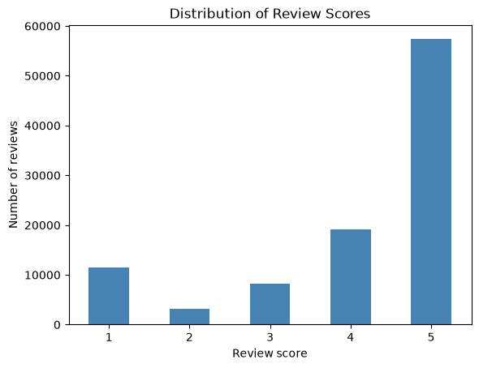
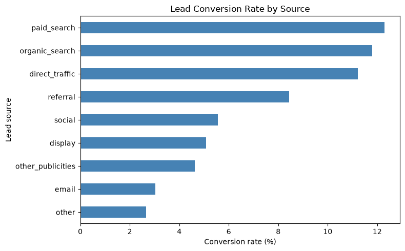
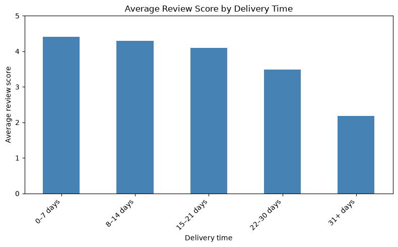

# Olist E-Commerce Data Analysis

## Project Overview

This project analyzes the Brazilian Olist E-Commerce dataset to identify patterns in customer satisfaction, product reviews, delivery performance, and lead conversion.

The goal is to transform raw business data into actionable insights that can help improve customer experience and operational decision-making.

## Project Highlights

## Olist E-Commerce Data Analysis | Python, Pandas & Jupyter Notebook

Analyzed Brazilian e-commerce data to uncover insights into customer satisfaction, delivery performance, product reviews, and marketing lead conversion.

## Key Achievements

- Analyzed 99,224 customer reviews, identifying an average satisfaction score of 4.09 out of 5.
- Identified that 57.8% of customers gave five-star reviews, while 14.7% gave one- or two-star reviews.
- Evaluated marketing channels and identified paid search as the highest-converting source at 12.30%.
- Examined the relationship between delivery times and customer satisfaction, finding that longer delivery times were associated with lower review scores.
- Created data visualizations and business recommendations to support customer experience and operational improvements.

## Technical Skills and Tools

- Python
- Pandas
- Matplotlib
- Jupyter Notebook
- Data Cleaning and Transformation
- Exploratory Data Analysis (EDA)
- Data Visualization

## Key Findings

- Average customer review score: 4.09 out of 5.
- Approximately 57.8% of customer reviews received five stars.
- Approximately 14.7% of reviews received one or two stars.
- Paid search achieved a lead conversion rate of 12.30%.
- Organic search achieved a lead conversion rate of 11.80%.

### Customer Review Score Distribution

### Lead Conversion Rate by Source

### Delivery Time and Customer Satisfaction

## Business Recommendations

- Investigate product categories with high numbers of negative reviews.
- Improve delivery performance to support customer satisfaction.
- Monitor lead conversion rates across marketing channels.
- Use customer feedback to guide operational improvements.

## Project Files

The project includes two Jupyter Notebooks containing Python code, data analysis, visualizations, and findings.

### View Project Files

- [Jupyter Notebook – Day 1](Capstone%20project%20day1%20%281%29.ipynb)
- [Jupyter Notebook – Days 4 and 5](Capstone%20project%20day4and5.ipynb)
- [Business Analysis Report (PDF)](BUSINESS%20REPORT%20final.pdf)
- [PowerPoint Presentation](Capstone%20python%20presentation.pptx)

## Conclusion

This project demonstrates practical skills in Python, Pandas, data cleaning, exploratory data analysis, and business reporting.

## Dataset Information

This project uses the Brazilian Olist E-Commerce dataset, including customer, order, product, review, delivery, and marketing lead data.

The raw CSV datasets are not included in this repository. The Jupyter Notebooks contain the analysis code and saved visualizations.

To reproduce the analysis, obtain the corresponding datasets from their original source and update the local data directory.